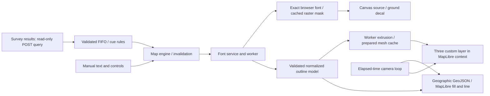

# GeoGlyph performance, stability and demonstration readiness audit

Audit date: **31 October 2026**. Status: **audit and proposed implementation plan only**.

The demonstration target is the GitHub-hosted conference `index.html`. Source paths and line numbers below are relative to `Locate 2026 version/` unless prefixed **Base**. The base studio was also inventoried, its differing sources compared, and its unit cases executed. The report is also copied to the workspace root for convenience.

**Application source was not edited during this audit.** At the user's separate instruction, the existing Explorer/QART/crosshair changes were reviewed, committed and pushed as `fc1996153199b3667827693d3a0479b99f427c7b`. This is the application baseline assessed here. Audit scripts, evidence and this report are new artifacts, separate from application code. No dependencies were added, credentials changed or survey records written.

## 1. Executive Assessment

**Current demonstration readiness: Not Ready for signoff.** This means the requested evidence and recovery gates have not been satisfied; it does not mean the application invariably fails. The implementation has a sound foundation and useful regression coverage, but reproducible interruption defects remain, accepted large texts can generate thousands of material draws, and the required physical-browser 60–120 minute stress test could not run in this environment.

The strongest implementation choices are worker-based outline parsing/geometry/extrusion, reuse of normalized 3D geometry for size/depth/pose changes, bounded model and mesh caches, an elapsed-time orbit with a single scheduled camera callback, cached orbit framing, atomic 3D swaps that preserve the previous model on rejection, explicit survey fields and keyset paging, cancellable non-overlapping polling, and last-display retention through network failures. Conference readiness uses style initialization rather than waiting for all remote tiles. These mechanisms should be preserved.

The most serious weaknesses are:

- Manual font selection during an asynchronous survey cue can leave the conference rebuild lock set, suppressing subsequent manual updates.
- Denied browser storage can prevent the core API from being created; storage write failures can interrupt later UI initialization.
- A worker timeout rejects its promise but leaves the same potentially stuck worker running and available for subsequent requests.
- Font downloads and several startup readiness waits have no deadline/restart path. One missing or indefinitely delayed font can prevent unattended startup.
- Camera zoom events can request complete rebuilds even when a 3D model is unchanged. Cache hits avoid triangulation but do not eliminate projection, GeoJSON submission and UI/history work.
- Mesh byte/vertex limits do not constrain material groups: a 1,000-glyph accepted mesh has 2,000 groups. GPU draw cost remains unmeasured.
- Whole-poll paging and the conference FIFO have no backpressure bound. Hidden-tab rendering pauses conflict with cue deadlines that use elapsed wall time.

Direct verification completed: **71 conference and 39 base unit cases passed**, an isolated conference build reproduced the existing generated artifacts byte for byte, deterministic failure probes reproduced five supporting-code defects and two network/state defects, and actual-source CPU/geometry benchmarks plus 600 unique worker updates completed. Those results do not substitute for graphics profiling.

Chromium/Playwright packages and browser runtimes are installed. Chromium launch fails with `sandbox_host_linux.cc ... Operation not permitted`; the missing layer is execution permission, not an absent package. No FPS, browser heap, GPU utilization, actual GPU draw duration, page startup latency or 60–120 minute browser stability result is claimed. Adding packages would not resolve that permission boundary.

### Architecture and repository examination

The workspace inventory contains 250 files outside dependencies, Git/private metadata and generated test reports, including 54 base and 66 conference `src/` files. Generated HTML, embedded assets, binary fonts/images, licenses, historical validation, plans, fixtures, build/development scripts and tests were included in inventory/relationship checks. Shared sources were compared by content; attention was concentrated on execution paths rather than rereviewing identical copies. Vendored libraries were examined at integration/lifecycle boundaries; this is not an independent line-by-line correctness audit of every third-party library.

| Area | Execution and ownership |
|---|---|
| Entry/build | `src/template.html`, ordered `src/assets.json`, `scripts/build.cjs`; static modular `index.html`, portable `dist/GeoGlyph.html` and `GeoGlyph_Locate_2026.html`. No application backend. Base portable name is `GeoGlyph_Studio_MapGeometry_v18.5.html`. |
| Studio/UI | `core.js` owns font/catalogue, glyph, canvas, QR/scan and settings state; versioned UI scripts augment the singleton API. `controls.js`, `studio-ui.js`, `colour-picker.js` and `map-controls-ui.js` enhance existing DOM. |
| Ground map | `geoglyph-map-engine-inline.js` owns MapLibre 5.3.0, raster basemaps, projection, outline/decal selection, rebuild invalidation, survey polling and cue transactions. |
| Fonts/geometry | `font-service.js` shares acquisition/FontFace work and communicates with the embedded classic worker. `ground-geometry.js` validates/flattens/unions contours and caches glyph shapes. |
| 3D | `ground-3d.js` is bundled with Three.js 0.186.1; a custom MapLibre layer shares the map's GL context. `ground-model-cache.js` owns prepared BufferGeometry/line resources. `ground-camera.js` owns orbit/framing scheduling; `ground-transform.js` contains pose math. |
| Workers | Build embeds OpenType, polygon-clipping, geometry and bundled `extrusion-entry.js` into `font-geometry-worker.js`'s worker source. The worker retains parsed fonts, normalized models and meshes. |
| Conference | `conference-config.js` enables default presentation; `conference-presentation.js` prepares six bundled fonts, stages overview/Begin/live, queues submissions and applies cues; `conference-cues.js` resolves pure rules; `survey-results.js` performs anonymous read-only ArcGIS queries. Base has no conference survey integration. |
| Services | Esri imagery/topographic tiles; optional user-configured MetroMap key; Survey123 results Feature Service in the conference edition. Local Font Access/files support authoring. Service URLs, keys and respondent text are omitted from new audit diagnostics. |



## 2. Performance Findings

Evidence labels: **Reproduced** = unchanged source executed with controlled dependencies; **Measured CPU** = actual-source Node measurement; **Source** = established execution path; **Unverified graphics** = consequence requires a real browser/GPU. Severity is impact-oriented; likelihood and scope are stated separately. No unconditional Critical crash was established.

### GG-01 — High — Superseded cue can leave rebuilding locked

**Source:** `src/scripts/geoglyph-map-engine-inline.js:1593–1599,1628–1634,1912–1922,1941–1965`.

**Problem/evidence:** A cue sets `conferenceApplying`; manual font selection changes `fontChoiceVersion`, and its queued rebuild is deferred by that flag. Old-cue cleanup only clears the flag if its former font version still matches. The reproduced final state is `conferenceApplying=true`, `conferenceRebuildPending=true`; a later manual request does not start another rebuild. Evidence: `audit/2026-10-31/network-repro-results.json`.

**Impact/recommendation:** Controls can appear frozen until a later cue or Reset happens to release the state. Give each conference transaction an explicit owner independent of selection version; only that owner may release its lock and flush pending work. Preserve latest-selection semantics and prevent old cleanup from unlocking a newer transaction.

**Regression/independence/verification:** Low–medium cancellation risk; independently implementable. Delay a cue's preparation, manually change fonts/text, release the old work, and verify updates resume without another survey response. Also supersede with a newer cue/Reset and retain active-camera behavior.

### GG-02 — High — Optional browser persistence can abort startup or UI work

**Source:** `src/scripts/core.js:49,414–416,444–452,2007`; `src/scripts/geoglyph-v1512-ux-ui.js:203–210,264–265`.

**Problem/evidence:** Theme storage is read before publishing `GeoGlyphStudio`; a simulated getter `SecurityError` prevents API creation. Unguarded theme/favourite/owner-map writes can also throw, including an owner-map write during UI startup. Reproduced getter and setter failures are in `ui-probe-results.json`. Likelihood is low in a normal working profile, impact is high when storage is denied/full.

**Impact/recommendation:** Use existing defaults/in-memory state when reads or writes fail, with small guarded helpers or local catches. Preserve storage keys and successful persistence behavior; no intrusive alert is needed.

**Regression/independence/verification:** Low risk and independent. Test denied getter, quota-failing setter and normal persistence; require core/map startup, theme, favourites, selection, undo and settings to remain usable.

### GG-03 — High — Worker timeout does not recover the worker

**Source:** `src/scripts/font-service.js:66–80,107–124,137–143`.

**Problem/evidence:** The 30-second timeout removes/rejects a pending job but neither terminates the worker nor starts a new worker generation. A deterministic stalled-worker probe makes two requests/timeouts and observes one worker creation, two posts and zero terminations. `onerror` does reset a crashed worker; that does not cover a worker stuck in synchronous computation. Some preparation errors are cached until explicit retry.

**Impact/recommendation:** Text preparation may remain unavailable after the first stall; queued obsolete computation can continue. On a genuine worker failure/timeout, invalidate that worker generation, terminate it, reject its pending jobs, clear/revalidate worker-dependent readiness, and permit a bounded retry from retained font bytes. Keep the last valid display. Do not blindly replay permanent font-policy failures.

**Regression/independence/verification:** Low–medium lifecycle risk; independent of geometry optimization. Simulate timeout, crash, late old-generation replies and concurrent pending jobs; require recovery on a new worker, settled promises and unchanged active geometry. Preserve ordinary `FONT_EVICTED` recovery.

### GG-04 — High — Startup font/readiness waits are unbounded and not restartable

**Source:** `src/scripts/conference-presentation.js:202–258`; `src/fonts/manifest.json:1–8`; `src/scripts/geoglyph-map-engine-inline.js:1515–1523`.

**Problem/evidence:** Online `fetch(font.file)` has no timeout/cancellation/retry; all six acquisitions gate startup. Host/dependency/map readiness use 20 ms polling without an overall deadline. A rejected startup ends in a catch without an idempotent restart API. The map watchdog only changes status. Source-established; hung-font browser scenario unexecuted.

**Impact/recommendation:** The map can be visible while opening artwork and polling never become ready. Bound acquisitions and dependency waits, retry transient downloads a small number of times, retain successful acquisitions, and provide controlled retry through existing operator controls/status. Preserve all exact fonts and overview/Begin behavior. The emoji font is 12,934,920 bytes; this is a file-size observation, not download timing.

**Regression/independence/verification:** Low–medium startup ownership risk; independent. Hold one font indefinitely, fail then restore it, and fail map/worker initialization. Require a deadline, one startup/polling instance and recovery without reloading or substituting fonts.

### GG-05 — High — Camera zoom can redispatch unchanged ground geometry

**Source:** `src/scripts/geoglyph-map-engine-inline.js:1558,1593–1599,1617–1626,1661–1667`; `src/scripts/ground-camera.js:137–160`; `src/scripts/geoglyph-v1512-ux-ui.js:268–282`.

**Problem/evidence:** Every `zoomend` requests a rebuild. MapLibre 5.3 `jumpTo` emits zoom events when zoom changes; the custom camera uses `jumpTo` repeatedly during framing/retarget interpolation. A cached normalized model still gets fresh geographic arrays, GeoJSON `setData`, style/control work and a rendered/history event. The unchanged-source probe confirms 100 unchanged rebuild calls cause 100 projections, submissions, commits and events. That is dispatch evidence, not a measured 100-frame browser trace. A steady orbit with constant zoom is not claimed to rebuild every frame.

**Impact/recommendation:** Predictable camera transitions can produce avoidable main-thread allocation and MapLibre source work. First suppress camera-only 3D rebuilds when the committed model/placement is unchanged; retain camera pose repainting. For 2D, rebuild only when the quantized outline/texture sampling requirement changes. Track geometry/projection/sampling keys explicitly. Maintain export data and first-frame/Fit ordering.

**Regression/independence/verification:** Low–medium for the narrow 3D guard; medium for broader 2D invalidation. Independent. Count worker jobs, projections, source updates and allocations through a full Fit/orbit/resize; unchanged 3D camera movement must not regenerate source data. Verify 2D close-up quality, pixel-width outlines and anchoring at all size/DPR presets.

### GG-06 — High — Material groups scale independently of geometry byte limits

**Source:** `src/workers/extrusion-entry.js:7–24`; `src/scripts/ground-model-cache.js:30–34`; `src/scripts/ground-3d.js:61–66,89–95`.

**Problem/evidence:** Cap/side groups are retained per shape. Measured accepted meshes: 223-character Gill Sans = 400 groups; Chiller = 1,008; 1,000 Gill Sans `A`s = 2,000 groups, 44,000 triangles and 3,696,000 mesh bytes. A material-array group is rendered separately. Nominal solid text plus one outline therefore implies roughly 401/1,009/2,001 draws, before basemap draws. These are structural predictions, not captured GPU draw calls. Transparent double-sided materials can require additional passes. [Three.js BufferGeometry groups](https://threejs.org/docs/pages/BufferGeometry.html#groups).

**Impact/recommendation:** A modest accepted buffer can still impose substantial per-frame driver/CPU overhead. Measure real draw counts, then batch cap/side ranges into a small number of groups while preserving positions, normals, holes, outlines, materials and lighting. Do not reduce curve quality or resolution to conceal this cost.

**Regression/independence/verification:** Medium risk: range ordering and transparent blending need visual tests. Independent, but not a one-line pre-demo fix. Compare solid/transparent/front/back/depth views and physical-GPU p95/p99; confirm batch draw counts and unchanged exported geometry.

### GG-07 — High under sustained traffic — Whole-poll paging and FIFO lack backpressure

**Source:** `src/scripts/survey-results.js:186–202`; `src/scripts/conference-presentation.js:5–8,78–85,145–178`.

**Problem/evidence:** Requests time out individually, but `afterCues` accumulates all pages before returning without page/row/byte/elapsed limits. Rendering is serial; polling can append an unbounded number of queued rows. The actual client accepted 100 synthetic full pages/2,500 rows with no partial delivery before the probe externally aborted request 101. A later-page failure discards that batch and it is downloaded again.

**Impact/recommendation:** A busy feed or recovery burst can grow memory and submission-to-display delay. Add bounded resumable page batches and backpressure from safely retained render work. Preserve FIFO, accepted cues, cursor correctness, Stop/Resume and Reset priority. Silently dropping/coalescing submissions would change behavior and is not recommended.

**Regression/independence/verification:** Medium sequencing risk; transport/queue parts should be designed together. Test arrivals faster than rendering, late-page failures, Reset behind a burst and eventual ordered delivery during the long soak. This is not a claim that current production traffic is excessive.

### GG-08 — Medium — Transient failures retry at normal cadence without Retry-After

**Source:** `src/scripts/conference-config.js:4`; `src/scripts/survey-results.js:78–109`; `src/scripts/geoglyph-map-engine-inline.js:637–643,1122–1132,1189–1199`.

**Problem/evidence:** 429/503 are generic errors; no `Retry-After` is retained. Fast failures can repeat every second; long failures are followed immediately when the interval is already due. Warning toasts repeat on each failure. Source-established, rate under live outage unmeasured.

**Impact/recommendation:** Honor valid server retry timing, add bounded jittered backoff for consecutive transient failures, reset after success, and deduplicate warning transitions. Preserve the requested healthy polling interval and anonymous POST queries.

**Regression/independence/verification:** Low risk; independent. Simulate 429/503/timeouts and connectivity return; assert bounded traffic, no overlaps, cancellable retry, correct interval edits and retained display.

### GG-09 — Medium — Visibility pauses and cue deadlines use conflicting clocks

**Source:** `src/scripts/ground-camera.js:136–150,190–197`; `src/scripts/ground-3d.js:105–122`; `src/scripts/geoglyph-map-engine-inline.js:1870–1908`; `src/scripts/conference-presentation.js:78–133,163–178`.

**Problem/evidence:** Camera rAF pauses while hidden; polling/draining has no corresponding visibility policy. A commit can wait for rAF while later rows accumulate. Frame/camera deadlines can expire while rendering is deliberately paused; failed rows have already been dequeued. Browser timer throttling determines the exact outcome, so this remains a source-supported scenario.

**Impact/recommendation:** Suspend render-specific deadlines/draining at a defined visibility boundary, retain active work, and resume once in order. Coordinate acceptance with backpressure; do not silently skip hidden-tab submissions.

**Regression/independence/verification:** Medium risk, coordinate with GG-07. Hide for 60 seconds during 2D/3D draw, Fit and Begin, then verify completion exactly once, ordering, no stale lock and bounded growth. Must use real visibility behavior, not only a mocked `document.hidden` value.

### GG-10 — Medium — Controls-only cues still take the complete model pipeline

**Source:** `src/scripts/conference-cues.js:46–70,90–95`; `src/scripts/geoglyph-map-engine-inline.js:1929–1949,1661–1685`.

**Problem/evidence:** Every resolved nonempty cue rebuilds, even a colour-only change. Caches avoid some triangulation but not projection/submission or decal recolouring. Source and unchanged-rebuild probe; browser savings unmeasured.

**Impact/recommendation:** Compare effective geometry, placement, pose, paint and sampling state; reuse retained resources for paint/transform-only changes. **A new content-bearing submission must still trigger its established automatic Fit even if its text equals the previous submission.** Do not deduplicate complete cues by string.

**Regression/independence/verification:** Medium dirty-state risk; independent after GG-05's keys are defined. Verify identical geometry and pixel output, stable source/worker/upload counters for paint-only cues and exactly one Fit for repeated content IDs.

### GG-11 — Medium opportunity — Per-frame pose math allocates and repeats work

**Source:** `src/scripts/ground-3d.js:24–37,74–95`; `src/scripts/ground-camera.js:18–29,159–160`.

**Problem/evidence:** Paint and render each compute matrices; camera pose can compute them again. Each call creates several Matrix4s, arrays and Mercator objects. Non-active camera-facing calculations iterate pose resolution up to six times. Material/line properties and canvas dimensions are reapplied on each custom render. This is source-established allocation, not a measured dominant bottleneck or proven forced-layout loop.

**Impact/recommendation:** Profile allocation/frame traces, then reuse scratch matrices and compute a coherent pose once per map frame; separate dirty paint/viewport from pose changes. Keep necessary GL state reset around the shared context.

**Regression/independence/verification:** Medium math/ownership risk; independently implementable after profiling. Test fixed/Turn/Face, active and stopped cameras, tilt, latitude, resize and alpha; compare pose/camera traces and retained allocations. Do not replace the cached framing solver merely for stylistic modernization.

### GG-12 — Medium opportunity — Raster paint rebuilds allocate large canvases and upload again

**Source:** `src/scripts/geoglyph-map-engine-inline.js:2028–2114,2149–2174`.

**Problem/evidence:** Masks are cached, but recolouring creates output/tint canvases and sometimes outer/inner outline canvases. Setting the ground decal resizes/clears/copies the target and refreshes the CanvasSource. A sampling change can regenerate up to a 4-megapixel mask; a single RGBA surface at that limit is 16 MiB before additional canvases/native/GPU copies. Source-derived size, not measured GPU allocation.

**Impact/recommendation:** Avoid identical raster updates, reuse safely owned scratch canvases after accounting for concurrent work, and cache complete paint/sampling results conservatively. Preserve native emoji colour, pixel-based outlines, shaping and existing resolution limits.

**Regression/independence/verification:** Medium canvas-lifetime/visual risk; independent. Repeated emoji/style/zoom changes must preserve pixels and texture resolution, reduce allocations/uploads, and reach a retained-memory plateau. No automatic quality downgrade is proposed.

### GG-13 — Medium capacity constraint — Valid large models can fail consecutive atomic swaps

**Source:** `src/scripts/ground-model-cache.js:28–39`; `src/scripts/geoglyph-map-engine-inline.js:1669–1671,1699–1705`.

**Problem/evidence:** Two actual 223/225-character Magneto models each pass in an empty cache, at 22,363,136/22,380,864 retained-budget bytes. The second fails with the first active because their sum exceeds 32 MiB. The probe confirms the old model stays undisposed. This is an intentional safety trade-off, not a leak.

**Impact/recommendation:** A message may work after reload yet appear stale after another large cue. Preflight consecutive longest required cues at exact fonts/quality. Preserve existing fallback/status. Any staging redesign or budget increase requires measured peak CPU/GPU headroom; simply lifting limits or reducing quality is not justified.

**Regression/independence/verification:** Low risk for rehearsal, medium–high for allocation redesign. Independent. Exercise large-to-large transitions and failure recovery, not only isolated messages.

### GG-14 — Medium measurement concern — Payload counters are not real heap ceilings

**Source:** `src/workers/font-geometry-worker.js:3–11,30`; `src/scripts/ground-geometry.js:125–153`; `src/scripts/font-service.js:18–23,42–64`; `src/scripts/ground-model-cache.js:28–35`.

**Problem/evidence:** Model accounting estimates vertices ×24, excluding nested-array/object/path overhead. Main font records/providers can retain `arrayBuffer` after a resource's `buffer` field is trimmed. Worker, main, font-face, canvas, MapLibre and GPU allocations have separate ownership. The CPU stress cache counters stabilize, while total forced-GC process heap is materially larger than their nominal payloads.

**Impact/recommendation:** Treat stats as estimated retained payload, not a hard application-memory bound. Capture retained browser heap, ArrayBuffers, native/GPU resources and catalogue ownership during the soak; add release only at genuine ownership end. Do not call page-lifetime singleton listeners or intentional catalogue retention leaks without growth evidence.

**Regression/independence/verification:** Low for measurement/documentation; medium for retention changes. Independent. Compare equal steady states after warmup/GC where appropriate; verify pinning, exact-face reload and BFCache return.

### GG-15 — Low opportunity — Parsed-font count thrashes the five-font conference set

**Source:** `src/workers/font-geometry-worker.js:5–9,17–31`; `src/scripts/font-service.js:120–124`; `src/scripts/conference-presentation.js:224–245`.

**Problem/evidence:** The five outline files total 348,232 bytes, but only two parsed fonts remain resident. Cycling 50 warm-model requests across the set causes 50 evicted-font retries and 55 parses including initialization. Isolated parse medians are only 0.046–0.211 ms here; large FPS gains are not claimed.

**Recommendation:** Return an existing complete cached model before requiring its parsed font, or use a small conference residency set within a measured real-memory budget. Preserve general catalogue eviction.

**Regression/independence/verification:** Low–medium; independent. Warm and cycle all faces, count avoidable parses/retries and retained glyph-cache memory. Do not increase a global cache limit blindly.

### GG-16 — Medium opportunity — Large changed models incur union and message-copy costs

**Source:** `src/scripts/ground-geometry.js:156–192`; `src/workers/font-geometry-worker.js:29–39`; `src/scripts/font-service.js:120–124,143`; `src/workers/extrusion-entry.js:16–24`.

**Problem/evidence:** Heavy Magneto still takes a median 110.943 ms to regenerate with warm glyph shapes because layout/overlap union remains. Its model clone median/p95/p99 is 9.072/10.010/23.476 ms in Node. Mesh generation is in the worker in the application, so these are not measured main-thread stalls. Full model payloads are sent back to a worker that may already retain the same model; results are cloned rather than transferred.

**Recommendation:** Keep worker execution and complete-model reuse. Consider key-only mesh requests with an explicit model-cache-miss fallback; coalesce obsolete manual requests before dispatch while preserving accepted conference FIFO. Preflight construction budgets before large transient allocations. Transferring the retained cached buffers directly would detach and break them.

**Regression/independence/verification:** Low–medium for key/miss handling, medium for scheduling, high for packed/incremental rewrites. Independent. Measure actual browser message/copy/long-task latency and prove stale results cannot commit; retain geometry/fallback policy.

### GG-17 — Medium — Export can pause animation and create high-resolution readback pressure

**Source:** `src/scripts/geoglyph-map-engine-inline.js:1204–1298,1504`; vendored MapLibre `src/vendor/geoglyph-maplibre-v530-vendor.js:3`.

**Problem/evidence:** Export pauses the camera, waits a frame, synchronously `readPixels`, allocates raw/flipped buffers, copies to canvas and optionally flattens JPEG. At a 3840×2160 actual backing size, each RGBA buffer is 33,177,600 bytes; several may coexist. There is no export-in-progress guard. Also top-level `preserveDrawingBuffer:true` is ignored by bundled MapLibre 5.3, which reads `canvasContextAttributes`; the actual default is false. Do not claim that disabling this already-ignored option would improve FPS. [Pinned MapLibre map source](https://raw.githubusercontent.com/maplibre/maplibre-gl-js/v5.3.0/src/ui/map.ts).

**Recommendation:** Guard overlapping exports, release frame listeners on timeout, verify capture in the intended rendered frame, and measure snapshot stalls. Decide explicitly whether frame-bound capture suffices or real drawing-buffer preservation is needed; enabling preservation may cost throughput. Keep full-resolution exported images.

**Regression/independence/verification:** Low for concurrency/listener guards, medium for capture timing/context attributes. Independent. Test both formats, 2D/3D, stalled/lost context and high-DPI output; verify real pixels and guaranteed animation resume on every failure.

### GG-18 — Medium verification gap — Context recovery lacks application-level coordination proof

**Source:** `src/scripts/ground-3d.js:53–101,246–252`; `src/scripts/geoglyph-map-engine-inline.js:1515–1585,1870–1908`; MapLibre vendor `:3`; `node_modules/three/src/renderers/WebGLRenderer.js:1113–1143`.

**Evidence:** MapLibre and Three already implement context-loss/restoration handling. Therefore “no context recovery” would be incorrect. Application cue deadlines, queued commits and last-state recovery are not explicitly coordinated with context state, and no loss/restore browser test could run.

**Recommendation:** First use `WEBGL_lose_context` on the exact shared context; verify basemap, custom mesh, canvas texture, camera and current cue after restoration. Add only the missing coordination/rebuild path shown by that test, retaining the last logical state and avoiding reload loops.

**Regression/independence/verification:** Low risk for testing, medium for recovery code. Independent with GG-03/GG-09 interaction. Require repeated losses/restores and settled resources; browser/driver crash recovery itself cannot be guaranteed by JavaScript.

### GG-19 — Medium in QART — Styling repeatedly regenerates unchanged QR matrices

**Source:** `src/scripts/core.js:19,1136–1148,1182–1188,1222–1286`.

**Problem/evidence:** Preview styling calls QRious, creates a 708×708 source and reads/scans its pixels even when encoded content/correction level are unchanged. That readback is 2,005,056 RGBA bytes before scanning. Obsolete render tokens protect completion but do not cancel earlier work. The fixed Magic Eye matrix is already cached and is not included in this finding.

**Recommendation:** A one-entry immutable matrix cache keyed by exact input and correction level is a small independent opportunity. Preserve extraction checks. Shared scratch canvas reuse requires separate concurrency analysis.

**Regression/independence/verification:** Low for exact-key caching, medium for broader coalescing; independent. Count encode/readback calls through palette/shape/quiet-zone changes; require identical PNG/SVG, valid QR decoding and correct content/level invalidation.

### GG-20 — Medium — Concurrent scan-result previews can overwrite authored QR text

**Source:** `src/scripts/geoglyph-v15-ui.js:409–441,465–470`; `src/scripts/core.js:1136–1148`.

**Problem/evidence:** A preview temporarily changes shared `qrInput.value`, awaits rendering, then restores its saved value. A second overlapping call can save the first temporary value and restore it over the authored value. Actual extracted functions reproduce `ORIGINAL-AUTHORED-VALUE` becoming `FIRST-SYNTHETIC-ROW`. This affects the optional QReverse workflow.

**Recommendation:** Render an explicit immutable content snapshot. A narrow serialization alternative must preserve the authored value across the entire operation and not overwrite a newer real edit.

**Regression/independence/verification:** Low–medium; independent. Delay font/render readiness, alternate rows/tabs and edit input during pending work; require latest output and preserved authored edits.

### GG-21 — Medium in scan/batch workflows — Work scales poorly with images and row count

**Source:** `src/scripts/core.js:1734–1765,1793–1837,1903–1967`; `src/scripts/geoglyph-v154-base-ui.js:140–173`; `src/scripts/geoglyph-v15-ui.js:274–296,465–473`.

**Problem/evidence:** Live imports have no bound; full-resolution jsQR decoding can run synchronously for up to 25 passes. Per-image progress replaces the whole table, giving quadratic row work over a batch. Export retains every PNG before writing, including directory export; no scan/export cancellation exists. Source-established scaling, no browser time/OOM reproduced. ImageBitmap cleanup already occurs in `finally`.

**Recommendation:** Profile required batches; later isolate cancellable decode work, update changed rows and stream directory output. Any import limits require an explicit policy. Downscaling can lose small codes and is not a fidelity-neutral fix.

**Regression/independence/verification:** Medium; individual changes separable, broad worker/table rewrites deferred. Check 10/100/1000 rows, large images, every detected/exported result, order, cancellation, peak heap and long tasks.

### GG-22 — Medium for malformed input — Settings accept invalid character state

**Source:** `src/scripts/core.js:1981–1983,1989`; compare stricter map validation `src/scripts/studio-ui.js:295`.

**Problem/evidence:** Any finite selectedCode is accepted before later `String.fromCodePoint`; the probe stores `0x110000` and reproduces RangeError. Failed settings loading can leave already-mutated state. Several finite design scalars also lack their control bounds; resource failure from these scalars is unproven.

**Recommendation:** Validate code integer/range before committing it; keep previous valid state or reject the file. Validate scalar candidates against established supported ranges without breaking intentional legacy compatibility.

**Regression/independence/verification:** Low for invalid-code rejection, medium for scalar normalization; independent. Round-trip valid old/new files, negative/fractional/maximum/out-of-range codes and failed-load rollback. Avoid changing the existing surrogate policy incidentally.

### GG-23 — Low runtime / high maintenance impact — CSS consolidation deletes its output

**Source:** `scripts/consolidate-css.cjs:7–9,34–43`; `src/assets.json` style entries.

**Problem/evidence:** With the current two non-vendor styles, the script writes merged `app.css`, then deletes all old style paths including that output. An isolated unchanged-script run exits successfully with `app.css` absent and a manifest still referencing it. It is not part of normal build/test/dev, and was not run against application files.

**Recommendation:** Exclude output from deletion, validate proposed paths first and make reruns idempotent. Do not perform unrelated CSS cascade cleanup before the demonstration.

**Regression/independence/verification:** Low for the output guard; independent. Run twice in a disposable copy, then build and compare appearance. Current deployed styling is not claimed broken.

### GG-24 — Low while pinned — Basemap coverage relies on private MapLibre internals

**Source:** `src/scripts/basemap-coverage.js:8–35`; `src/scripts/ground-camera.js:49–105`; `src/scripts/geoglyph-map-engine-inline.js:1507–1510`.

**Problem/evidence:** The guarded near/far/tile-AABB adapter and camera fitting use internal transform APIs. They have compatibility checks and tests and solve demonstrated coverage problems; removal is not an optimization. A library upgrade could invalidate them without a public API guarantee.

**Recommendation:** Keep the embedded version pinned and preserve the adapter. Add explicit compatibility/coverage gates to any later upgrade; no pre-demo dependency modernization is justified.

**Regression/independence/verification:** Low for a version gate, high for removing/replacing the compatibility mechanism. Independent. Require elevated-camera basemap coverage and full-rotation/fit tests on the actual upgraded build.

### GG-25 — High operational verification gap — Hosted entry point is not established

**Source/evidence:** `index.html`, `README.md` launch instructions; `audit/2026-10-31/hosting-check.txt`. GitHub public visibility and source `main` at `fc19961` were verified. The conventional `https://frakntoastr.github.io/geoglyph-locate-2026/` returned HTTP 404; anonymous and authenticated Pages API reads also returned 404. A later subprocess recheck was blocked at DNS resolution. The exact presentation URL was not supplied, so this does not establish that every possible hosting URL is unavailable.

**Impact/recommendation:** A current repository is not proof of a runnable hosted app. Verify the operator's exact URL and relative script/font/worker paths from a clean browser, its actual source revision and offline fallback. No hosting settings were changed by the audit.

**Regression/independence/verification:** Low for read-only verification; hosting changes need their own review. Independent and a release gate. Navigation must reach the opening/map and live mode without local development dependencies.

### GG-26 — Low — Development server stream errors can escape

**Source:** `scripts/dev-server.cjs:15` (both editions).

**Evidence/impact:** A statted file can disappear/become unreadable before `createReadStream`; the stream has no error listener. Potential development-server interruption is source-derived and not reproduced. It does not affect GitHub static hosting.

**Recommendation/regression/independence/verification:** Handle a stream failure once and safely terminate its response; low risk, independent. Exercise a disappearing/unreadable file in an isolated server before changing this maintenance path.

## 3. Ranked Optimisation Opportunities

Benefit estimates are qualitative; no invented FPS or percentage improvement is attached to an unmeasured browser change. All recommendations require regression checks. “Independent” in the findings means a patch can be isolated, not that its tests can omit interacting behavior.

| Rank / finding | Expected performance benefit | Demonstration reliability benefit | Complexity | Regression risk | Evidence |
|---|---|---|---|---|---|
| 1 / GG-01 owner-safe cleanup | Removes suppressed updates | High: avoids persistent apparent freeze | Small–medium | Low–medium | Reproduced |
| 2 / GG-05 narrow camera invalidation | High potential reduction in transition spikes | High: smoother framing | Small–medium | Low–medium for 3D guard | Source + dispatch probe; frame gain unmeasured |
| 3 / GG-02 guarded persistence | Negligible steady-frame change | High conditional: prevents startup abort | Small | Low | Reproduced |
| 4 / GG-03 worker recovery | Prevents repeated stalled requests | High conditional: recovers text pipeline | Small–medium | Low–medium | Reproduced |
| 5 / GG-04 bounded startup/retry | Predictable startup/recovery | High on poor connections | Medium | Low–medium | Source |
| 6 / GG-08 failure backoff | Less outage traffic/UI churn | Medium | Small | Low | Source |
| 7 / GG-06 material batching | Potentially high every-frame benefit for long text | High if long text is required | Medium | Medium | Measured structure; GPU benefit unverified |
| 8 / GG-07 paging/backpressure | Bounded backlog/work | High during sustained audience input | Medium | Medium | Reproduced bound absence |
| 9 / GG-09 visibility policy | Avoids hidden-tab work/deadline conflict | Medium–high | Medium | Medium | Source scenario |
| 10 / GG-10 dirty cue paths | Fewer identical model/source/raster updates | Medium | Medium | Medium | Source + dispatch probe |
| 11 / GG-19 immutable QR cache | Removes repeated encode/readback | Medium if QART is demonstrated | Small | Low | Source; timing unmeasured |
| 12 / GG-20 immutable preview input | Less overlapping work | Medium if QReverse is shown | Small–medium | Low–medium | Reproduced |
| 13 / GG-17 guarded frame capture | Lower overlapping export peaks | Medium | Small–medium | Low–medium | Source; visual proof needed |
| 14 / GG-22 settings validation | Prevents invalid-state work | Medium for imported settings | Small | Low for code validation | Reproduced |
| 15 / GG-16 key-only mesh requests | Less large payload copying | Medium for changed heavy text | Medium | Low–medium | Measured CPU clones |
| 16 / GG-11 scratch pose/dirty paint | Lower per-frame allocations | Potentially medium | Medium | Medium | Profiling hypothesis |
| 17 / GG-12 raster reuse | Lower canvas/texture churn | Medium for emoji updates | Medium | Medium | Source; graphics unmeasured |
| 18 / GG-15 font residency/cache lookup | Fewer parse retries | Small–medium | Small–medium | Low–medium | Measured, small absolute parse cost |
| 19 / GG-21 scan/batch scaling | High for large optional batches | Low for default map demo | Medium–large | Medium | Source |
| 20 / GG-23 maintenance output guard | Prevents destructive maintenance result | Conditional medium | Small | Low | Reproduced in copy |
| 21 / GG-26 dev stream guard | No hosted-render benefit | Low | Small | Low | Source |

GG-13/14/18/24/25 are capacity, measurement, recovery-validation or deployment gates; complete their specific checks before deciding on structural changes. They are not a reason to raise budgets, rewrite libraries or change hosting speculatively.

## 4. Rendering Pipeline Assessment

### Ground text, buffers and draw submission

Outline text is laid out into a normalized model, with adaptive flattening, contour validity checks and union for overlaps. The worker does expensive font/geometry/mesh operations away from the browser main thread. The main thread projects every accepted vector model into geographic coordinates and submits MapLibre GeoJSON. In 3D it also obtains a normalized extrusion and renders it through the custom Three layer; the underlying 2D source remains part of the update path even when its layers are hidden.

Text/font/layout/quality changes can require new model and mesh buffers. Size, depth, tilt, bearing, colour and camera changes should usually reuse unit geometry. The implementation already does much of that reuse, particularly main 3D cache hits. It does **not** reconstruct an entire MapLibre map for every text update. GG-05 and GG-10 concern excess projection/source/raster work around retained geometry, rather than asserting every update rebuilds the whole scene.

The major structural GPU opportunity is material grouping (GG-06). Byte/triangle budgets alone do not ensure a cheap draw list. The active layer generally owns one scene, mesh, line object and a small material set; material reuse is good. The many geometry groups still become separate draws. Shader complexity is comparatively restrained: unlit front, Lambert side lighting and screen-width outline shaders, with no application shadow map or postprocessing stack. First-use shader/program creation and solid/transparent switches need tracing before any prewarming is proposed.

Solid mode disables mesh transparency; transparent/double-sided mode can increase passes and overdraw. Preserve that visual behavior. Disabling outlines, reducing opacity fidelity, lowering texture resolution, dropping DPR or simplifying curves is not included in the low-risk plan.

### Scheduling, frame consistency and resolution

The camera uses elapsed time, clamps long deltas, pauses on visibility and prevents duplicate scheduled callbacks. MapLibre's separate renderer rAF is necessary; two differently owned loops are not evidence of duplicate simulation. Orbit fits sample projected bounds and cache by model/pose/location/viewport. That cache should be retained; cold fits may allocate substantial projection trial state but are not recomputed on every unchanged orbit frame.

Prioritize transitions and dirty-state errors over mean FPS: camera-driven rebuilds, message copies, canvas uploads, first shader use, high group counts and cold/random-font work are credible spike sources. Only actual traces can rank their contribution to rendered frame-time tails.

No application pixel-ratio override is set. Backing resolution therefore follows renderer/device rules and available canvas limits. Test actual projector/external-display DPR and dimensions. A resolution cap would have a visual trade-off and needs explicit review; it is not a default recommendation. Verify actual context attributes rather than trusting obsolete top-level map options (GG-17).

## 5. Memory and Lifecycle Assessment

| Resource | Current ownership/bound | Assessment |
|---|---|---|
| Worker parsed fonts | Count 2 plus nominal 64 MiB source bytes | Bounded; conference font churn exists. Parsed/glyph memory exceeds source bytes. |
| Worker models/meshes | Separate nominal 32 MiB caches | Eviction observed in CPU stress; nested JS overhead not fully counted; a single exceptional item can exceed an estimate. |
| Prepared 3D cache | At most 3 entries / nominal 32 MiB, active protected | Hits avoid worker rebuilds; eviction/clear dispose geometries. Active+candidate budget intentionally blocks some large swaps. |
| Main font resources/faces | 64 MiB resource-buffer estimate, limited inactive FontFaces, pinned active owners | Provider/catalogue references may retain bytes independently; not a true total cap. General catalogues grow with explicit imports. |
| Raster masks | At most 8 / nominal 32 MiB, with one-entry allowance | Additional output/tint/target/GPU surfaces are outside this estimate. |
| Conference history | 1,000 phase records | Bounded. Queue itself is unbounded and materially different. |
| Undo/recent colours | 60 state snapshots / 12 colours | Bounded; snapshots exclude geometry/camera. Serialization still repeats on rendered events. |
| Listeners/observers | Mostly singleton, guarded initialization; repeated panels reuse DOM | No recurring panel-open listener leak established. Broad observers can add redundant work, but are not automatically leaks. |

The 600-update CPU probe observed cache eviction and a later heap plateau. It cannot establish a browser/GPU plateau across hours. Retained caches naturally warm before stabilizing; a rising early heap is not by itself a leak. Compare equivalent warmed states and include external ArrayBuffer/native memory and GPU resources.

3D clear removes the custom layer, disposes materials/renderer and clears owned cached geometry. Pending cache generations reject stale work. Pagehide clears 3D; persisted pageshow requests rebuilding. Font/catalogue singleton lifetime is intentionally broader than a panel; disposing it on every close would risk breaking exact-font state. Context recovery and repeated BFCache/visibility/resize behavior still require browser verification.

The current public-input exposure deserves attention: cue FIFO/backlog, queued obsolete worker work and large raster/geometry transient allocations can rise even where individual caches are bounded. Scan/batch imports are another explicit-data growth path, not an idle leak.

## 6. Network and External Services Assessment

The conference client uses anonymous access with `credentials:'omit'`, explicit approved field names, geometry only when required, ordered latest startup selection and ascending Object ID keyset paging thereafter. POST `/query` is a read-only query operation and intentionally avoids a previously documented cached-GET behavior; changing it back to GET for convenience could make displayed data stale. The API supports both request methods. [Esri query reference](https://developers.arcgis.com/rest/services-reference/enterprise/query-feature-service-layer/).

Each request has an AbortController, 15-second timer and finally cleanup. The polling generation rejects late responses; a busy flag prevents overlap. Stop, layer/mode changes and restart invalidate old work. Discovery is sequential and cached. Access/schema/selection errors stop polling, preserving the established security model rather than attempting authentication changes. There are no access tokens to refresh in this anonymous feed implementation; MetroMap has a separate user-provided key and must keep its existing handling.

Healthy conference polling defaults to one second: approximately 60 query requests per minute per open presentation tab when each poll is one fast page, calculated from configuration, **not measured production traffic**. Extra paging increases that count; slow requests reduce it. Authoring starts at five seconds and only rebuilds when the relevant message changes. Conference submissions use identity/FIFO semantics: an unchanged poll is not replayed, but two distinct content submissions can intentionally Fit even if their strings match.

Fetch awaits do not synchronously block animation. Parsing/processing and subsequent model/raster commits can compete with rendering; that is where network-induced visible pauses must be measured. Normal transient network errors keep the previous display and retry. Gaps: no failure backoff/Retry-After, whole-poll bound or queue backpressure; startup fonts have different and weaker timeout behavior than survey requests. Successful logical display retention does not guarantee new basemap tiles are available during an outage.

No new evidence contains respondent messages, authorization headers, tokens, API keys or the configured service identifier. Probe records are synthetic. Historical validation is useful context only and is not treated as a current live endpoint or latency test.

## 7. Demonstration Risk Register

Likelihood is conditional on the stated trigger and is an engineering assessment, not a measured failure probability.

| Priority / failure | Likelihood / impact | Detectability | Mitigation and gate |
|---|---|---|---|
| 1. Wrong/unavailable hosted URL | Unresolved / show-stopping | Immediate clean-browser navigation | Verify actual hosted URL/revision/assets; keep tested portable fallback. GG-25. |
| 2. Manual controls stop updating during a cue | Medium with mixed operator/audience use / High | Existing visual stale state; flags show lock | Owner-safe cancellation, delayed-work regression. GG-01. |
| 3. Startup never reaches live readiness | Medium on cold/poor connection / High | Map may be visible while ready stays false | Bounded font/readiness waits, retry, rehearse cold start. GG-04. |
| 4. Stuck font worker leaves updates unavailable | Low–medium conditional / High | Repeated 30-second failures, old display retained | Worker generation restart and late-reply test. GG-03. |
| 5. Long text collapses frame consistency | Medium with complex/long 3D text / High | GPU trace/material groups; visible orbit stutter | Profile actual fonts/text; batch groups only after validation. GG-06. |
| 6. Camera Fit/retarget microstutters | Plausible / Medium–High | Projection/setData trace, frame tails | Narrow unchanged-camera invalidation fix. GG-05. |
| 7. Audience backlog becomes stale or grows memory | Medium under burst/slow renderer / High | Queue high-water and oldest-cue age | Bounded resumable paging/backpressure preserving FIFO. GG-07. |
| 8. Storage restriction aborts application | Low in known profile / High | Missing core API or partial UI startup | Guard optional persistence; failure injection. GG-02. |
| 9. Large cue/font combination rejects | Confirmed for some inputs / Medium–High | Operator status; previous visual remains | Rehearse exact phrases and consecutive large swaps; preserve validation. GG-13. |
| 10. Backgrounding loses/defers a cue | Plausible / Medium–High | Compare applied IDs/queue after return | Visibility/deadline policy and 60-second hide tests. GG-09. |
| 11. Service outage or throttling | Plausible at venue / Medium–High | Existing status plus request trace | Last-value retention, bounded backoff, live reconnection test. GG-08. |
| 12. Graphics context loss/black surface | Hardware-dependent / High | GL events and rendered-frame/pixel check | Exercise shared-context loss/restore; coordinate only demonstrated gaps. GG-18. |
| 13. Export causes pause/memory peak | Medium at high backing size / Medium | Snapshot latency/memory | Guard overlap, capture/resume regression. GG-17. |
| 14. QReverse/QART corruption or unresponsiveness | Conditional on optional workflows / Medium–High | Content comparison, long tasks | Fix shared-input race; preflight required batches. GG-19–22. |

Diagnostics should remain confined to the audit harness, DevTools or existing unobtrusive operator status. No new presentation overlay or persistent warning banner is recommended.

## 8. Benchmark Results

### Environment, methods and repeatability

Actual-source CPU benchmarks ran with Node **v22.23.2**, project-local esbuild/Three and vendored OpenType/polygon-clipping on **AMD Ryzen 9 7950X3D**, 32 logical CPUs, Linux/WSL2 kernel `6.18.54.1-microsoft-standard-WSL2`, approximately 33.2 GB host RAM. The host was shared without CPU isolation. The classic worker protocol ran in a Node VM with structuredClone at both boundaries; it was not a browser worker and had no GPU or DOM.

Parse: 20 samples after 3 warmups. Cold model: 12 fresh parsed fonts, parsing excluded. Warm glyph-cache model: 50 samples after 5 warmups. Extrusion: 20 after 3 warmups. Clones: 50 after 5 warmups. Worker cached requests: 100 after 10 warmups; main-cache lookups: 1,000. Percentiles use nearest rank. Twelve-sample cold p95/p99 equal the maximum and must not be mistaken for reliable frame-tail statistics. JSON includes all sample counts, means, medians, p95/p99/min/max and source hashes.

Synthetic texts: `GeoGlyph` (8 characters), `GeoGlyph\nLocate 2026` (20 including newline), and eight repetitions of `GEOGLYPH LIVE VISUALISATION ` trimmed (223). Quality 10; 3D tolerance `2/11`; tracking 0; line height 1.15. Warm glyph timing still regenerates a complete changed-text model and is not cost paid on each unchanged animation frame.

| Font / workload | Cold model median / p95 ms | Warm glyph model median ms | Extrusion median / p95 / p99 ms | Mesh MiB | Groups |
|---|---:|---:|---:|---:|---:|
| Gill Sans / short | 1.862 / 9.141 | 0.033 | 2.885 / 3.673 / 6.141 | 0.363 | 16 |
| Gill Sans / normal | 2.617 / 3.286 | 0.172 | 6.688 / 7.158 / 7.362 | 0.934 | 36 |
| Gill Sans / heavy | 24.651 / 57.834 | 21.246 | 35.614 / 42.397 / 50.027 | 4.875 | 400 |
| Chiller / normal | 2.930 / 5.778 | 0.051 | 5.512 / 6.250 / 10.852 | 0.705 | 76 |
| Chiller / heavy | 51.276 / 62.134 | 49.753 | 75.301 / 88.917 / 90.498 | 9.097 | 1,008 |
| Magneto / normal | 6.944 / 10.334 | 4.848 | 9.223 / 10.014 / 13.439 | 1.190 | 16 |
| Magneto / heavy | 113.296 / 139.332 | 110.943 | 147.724 / 159.320 / 160.672 | 17.908 | 256 |
| Showcard Gothic / normal | 2.885 / 6.013 | 0.062 | 6.442 / 7.368 / 7.432 | 0.904 | 36 |
| Showcard Gothic / heavy | 2.901 / 3.754 | 0.468 | 50.351 / 56.185 / 56.287 | 6.447 | 400 |

All short/normal/heavy rows for all five fonts, including parse/clone statistics, are in `geometry-results.json`. Forte accepts the short text but rejects the normal/heavy phrases under the existing self-crossing-outline policy. This is an established compatibility boundary, not grounds to weaken validation. Random font selection should continue trying valid candidates; explicit 3D font/text choices must be rehearsed.

Other directly measured results:

- Normal Gill Sans repeated worker model/mesh requests: medians **0.300 / 0.953 ms**, with one retained model, one mesh and one mesh build. Main-cache 1,000 repeated prepares required **one worker build**, 1,000 hits and no eviction; bookkeeping lookup median below 0.001 ms.
- Five-font cycle: **50/50 evicted retries**, 55 parses including setup. Median/p95 retry latency **0.384 / 16.923 ms**; early tails include first-time geometry. This does not establish a large steady FPS gain from font residency alone.
- Two heavy Magneto candidates each fit alone but fail the combined active/candidate budget, retaining the old model. See GG-13 and `geometry-capacity-probe.json`.
- **600 distinct worker updates:** total request latency median/p95/p99 **100.552 / 117.662 / 156.466 ms** in the VM probe. After 300/600 updates, forced-GC process heap was **122,491,016 / 123,053,064 bytes** (approximately 116.8/117.4 MiB); model estimates were about 32 MiB and mesh payloads about 30–31.5 MiB. This indicates a later plateau in this probe. The high RSS starting point followed other benchmark phases and is not a cold-page baseline. About 62 seconds of processing is not an hour-long soak.
- Whole geometry harness wall time **85.781 s**; user/system process CPU **100.381/8.874 s** across benchmark phases/GC. These are benchmark process totals, not application CPU utilization.
- Source/build inventory: modular index **670,384 bytes**; identical portable files **21,150,660 bytes**, SHA-256 `e71fc5a1b22cb9d8c04d16190a5b9ed79a4264cbb9814daabebaace6e6bbfe0f`; six raw fonts total **13,283,152 bytes**. Transfer compression/cache behavior was not measured.

### Verification actually performed

| Check | Result / interpretation |
|---|---|
| Conference unit cases | 71 passed across 8 files, each executed directly with Node and named case-level TAP retained. |
| Base unit cases | 39 passed across 6 files by the same method. |
| Standard `node --test` invocation | Reported only file-level successes in this restricted environment; not used as the sole case-count evidence. |
| Isolated build | Success; index, both portable HTML files, 3D/extrusion bundles, version and font pack match existing artifacts exactly. Application source was not rebuilt in place. |
| Failure probes | Cue-lock race, unbounded paging, worker timeout reuse, unchanged rebuild dispatch, denied storage, favourite write error, QR input race, invalid settings code and CSS self-deletion reproduced with explicit mocks/disposable copies. |
| Browser benchmark harness | Syntax checked and independently reviewed; actual launch failed. `browser-attempt.json` records blocked launch, not successful completion. |
| Existing historical browser reports | Inspected for coverage/context; prior successes are not current-run results and some latest changes had only targeted prior checks. |

### Unavailable measurements

No current measured idle/normal/heavy **browser** FPS, median/p95/p99 rendered frame times, 1% low FPS, long-task distribution, actual browser load/first-use time, browser heap snapshots/growth, GPU utilization/allocated VRAM, GPU timer-query duration, observed draw counts, rendered text latency, live service latency/frequency or high-DPI output is available. Node CPU times must not be converted into browser FPS. Installed runtimes could not launch under session permissions. No additional package was needed for the completed measurements.

The actual physical GPU/driver, browser version/profile, projector refresh/DPR and venue connection remain unspecified. Those facts must be recorded for final signoff. Source inspection and synthetic network probes do not verify current sharing, schema, cache headers or live response order of the production service.

### Repeatable commands

From the conference directory, use existing dependencies:

```sh
rtk proxy node --expose-gc audit/2026-10-31/geometry-benchmark.cjs
rtk proxy node audit/2026-10-31/geometry-capacity-probe.cjs
rtk proxy node audit/2026-10-31/network-repro.cjs
rtk proxy node audit/2026-10-31/rendering-probes.cjs
rtk proxy node audit/2026-10-31/ui-probes.cjs
rtk proxy node node_modules/@playwright/test/cli.js test --workers=3
```

Do not run `npm test` on the audit baseline merely to obtain browser results: its wrapper first writes build outputs in place. The direct Playwright command uses existing generated files. Its configured reports may overwrite old generated test reports; use an isolated checkout or alternative output configuration if historical reports must be retained.

In a browser-capable environment, start the existing development server in one terminal (it does not build), then run the audit harness in another:

```sh
rtk proxy node scripts/dev-server.cjs
rtk proxy node audit/2026-10-31/browser-benchmark.cjs --headed --live-tiles --minutes 90 --dpr 1 --output audit/2026-10-31/browser-90min.json
```

The harness expects conference port 4174; pass `--url` for another already-served build. It intercepts the configured survey service with synthetic schema/records and never writes survey data. It exercises overview/Begin, idle/orbit, repeated text/font/mode/size changes, bursts, resize and recurring simulated outages/slow responses. Default tiles are a fixed fixture for isolation; **use `--live-tiles` for a representative visual run**. Its page-error, queue, actual map-render, pending/failed latency and final-state data must be reviewed. `collection-completed` is not an automatic pass or readiness signoff.

Collected rAF intervals are scheduling measurements, not GPU completion. Average rAF FPS is samples / total interval time; 1% low is 1000 divided by mean slowest 1% interval. A separately counted MapLibre render stream helps detect a stopped application behind a still-running audit rAF. CDP TaskDuration/wall gives renderer main-thread occupancy, not total CPU. JS heap excludes native/GPU memory. The bounded pending measurement records are reconciled/expired so failed cues do not create an artificial unbounded leak.

Supplement with DevTools Performance/Memory and WebGL draw/resource inspection on the physical presentation machine. Record idle, steady orbit, Fit, normal/long changed text, native emoji, cold random fonts and export separately. Use the same viewport/DPR/browser/power mode/warmup/network fixture before and after each authorized patch; compare frame-tail spikes, not only average FPS.

## 9. Proposed Implementation Plan

No item below is implemented. Each approved change should be a separate surgical patch/commit, tested against `fc19961` and the retained benchmark sources/results before moving to the next. Revert or revise a patch that changes required pixels, animation/interaction, cue ordering, authentication or recovery behavior even if its mean throughput improves.

### Tier 1 — Five highest-value improvements with comparatively low regression exposure

| Order | Proposed change | Expected benefit and supporting evidence | Verification before next patch |
|---|---|---|---|
| 1 | GG-01: transaction-owned lock cleanup | Prevents a reproduced persistent manual-update lock after asynchronous cue supersession. | Delayed old cue + manual selection + later manual text; newer cue/Reset ownership; active animation continuity. |
| 2 | GG-02: guard optional storage reads/writes | Prevents reproduced core startup abort and quota-induced partial UI initialization; no visual change on healthy storage. | Denied getter/setter; usable map/theme/favourites/undo; normal saved profile reload. |
| 3 | GG-05: narrow unchanged-3D camera invalidation | Removes repeated projection/GeoJSON/UI work around a cached model during zoom transitions; 100 unchanged builds redispatched work 100 times in the probe. | Actual browser counters and p95/p99 during Fit/retarget; unchanged mesh/GeoJSON/export/appearance; retain 2D adaptive detail. |
| 4 | GG-03: worker generation recovery | Prevents a single stalled worker from making later requests repeatedly time out. | Stall/crash/old replies/pending jobs; bounded retry; preserve last display and valid-font behavior. |
| 5 | GG-04: bounded font/startup acquisition with controlled retry | Makes cold startup recoverable after a held/failed font response; all dependencies currently gate readiness without an overall bound. | Hung font/fail-then-success/missing worker/map failure; exactly one startup/poller; exact opening fonts and sequence. |

These are the recommended five, not a claim that all five are equally trivial. The owner/recovery changes still need asynchronous regression tests. If only optional authoring workflows are in scope, GG-19 is an additional small low-risk opportunity; it should not displace the ground-text interruption fixes for this demonstration.

GG-08 backoff is the next small independent network improvement. Its maximum retry delay must be chosen against acceptable recovery latency; normal one-second healthy polling should remain unchanged.

### Tier 2 — Required validation and controlled improvements before demonstration

1. Establish the exact runnable hosted revision and portable fallback (GG-25); record browser/GPU/driver/refresh/DPR and test a cold profile with no font-scan permission.
2. Run the full current browser suite, targeted failure injections and pixel/geometry comparisons. Investigate GG-06 on the physical GPU. Batch materials only if traces justify it and solid/transparent appearance remains identical.
3. Implement backpressure/resumable paging and visibility/deadline coordination if audience traffic/background operation is required. Preserve FIFO, Reset, Stop/Resume and automatic Fit semantics. Do not substitute a latest-only feed without explicit product approval.
4. Preflight exact presentation fonts, messages, longest sizes, native emoji and consecutive large-model swaps; preserve outline validation and budgets. Test export and shared-context restoration.
5. Complete a **60–120 minute continuous browser run**, preferably 90 minutes or longer, with repeated ground-text changes and simulated network failure/latency. A 90-minute fixture run plus a real hosted/venue rehearsal is stronger than either alone.

Minimum long-run scenarios: steady animation and idle; repeated all-five-font text/emoji changes and bursts; longest accepted 2D/3D text; fullscreen/resize and DPR/external-display changes; a 60-second hidden interval during Begin/Fit/commit; offline/429/503/slow responses then recovery; repeated context loss/restore; panel open/close and snapshot export; Stop/Resume and manual changes while a cue is pending.

Acceptance gates: no uncaught errors, blank/stuck surface, lost/duplicate/reordered accepted cues or latched busy flags; healthy updates and animation recover without reload; unchanged scene resources stay stable; warmed heap/GPU resources plateau without sustained equal-workload growth; no unexpected reload/process crash. At 60 Hz inspect the 16.67 ms budget and repeated >33.3/>50 ms gaps, compare median/p95/p99 and 1% lows across equal phases, and distinguish intentional transitions from unexplained stalls. A stable 60 FPS result is preferable to a higher average with repeated visible pauses. Final numeric headroom must come from actual hardware evidence; it cannot be promised by this audit.

### Tier 3 — Post-demonstration or experimental work

After evidence justifies it: scratch matrix/pose reuse, raster scratch/cached-paint reuse, key-only worker mesh lookup/packed transferable representations, conference parsed-font residency, cancellable scan workers/incremental scan tables/streaming export, and more ambitious cache-budget redesign. Keep QR/settings/maintenance correctness fixes separate from these architectural changes.

Do not combine a library upgrade, shader replacement, CSS cleanup, WebGPU rewrite, universal typed-array migration, emoji subsetting, reduced DPR or relaxed outline validation with pre-demo reliability patches. Such changes introduce visual/compatibility trade-offs and require their own measured case. Preserve the MapLibre coverage adapter and existing private-font preparation compatibility.

## 10. Final Readiness Assessment

**Not Ready for public-demonstration signoff at the audited baseline.** The main reasons are the reproduced update-lock/startup/recovery defects, unprofiled material-group scaling and the absence of the explicitly required continuous graphics/network-failure test. A public repository and passing CPU/unit checks alone do not establish a reliable hosted live visualization.

The highest-value proposed changes are the five Tier 1 items. Remaining significant risks are sustained-feed backlog, context/visibility coordination, long-message font/budget compatibility, actual high-DPI GPU frame tails and an unverified hosted entry point. The long-run test must be completed after approved fixes on the actual display machine, with baseline comparisons and no appearance/behavior regression.

Before signoff, require: complete browser regressions; exact URL/source/assets cold start; storage/font/worker failure recovery; manual-cue supersession; network timeout/throttle/reconnect with last-value retention and ordered catch-up; context restore; consecutive longest cues; all animation orientations and image export at presentation resolution; fullscreen/visibility/display transitions; and the 60–120 minute memory/frame-consistency soak.

Not verified here: real rendered pixels, current browser frame metrics, GPU utilization/durations/resources, live production survey latency/sharing/schema, physical projector/display transitions, true background timer throttling and hours-long browser stability. The browser harness is prepared and syntax reviewed but could not execute past launch. These omissions are release gates, not fabricated successful measurements.

The audit ends with this report and implementation proposal. **Application optimizations await explicit approval of the selected changes.**

### Evidence index

All new evidence is under `audit/2026-10-31/` in the conference repository:

- `inventory-baseline.json`, `build-parity.json`, `unit-summary.json` and individual case-level unit logs.
- `geometry-benchmark.cjs`, `geometry-results.json`, `geometry-run.log`, `geometry-capacity-probe.cjs/json`, `geometry-findings.md`.
- `network-repro.cjs`, `network-repro-results.json`, `network-findings.md`.
- `rendering-probes.cjs/json` for worker-timeout and unchanged-rebuild dispatch.
- `ui-probes.cjs`, `ui-probe-results.json`, `ui-findings.md` for supporting-code inspection and isolated reproductions.
- `browser-benchmark.cjs`, `browser-attempt.json`, `hosting-check.txt`.

Any raw service requests in older repository tests/validation predate this audit; new public audit evidence uses synthetic records and excludes service credentials and respondent content.
